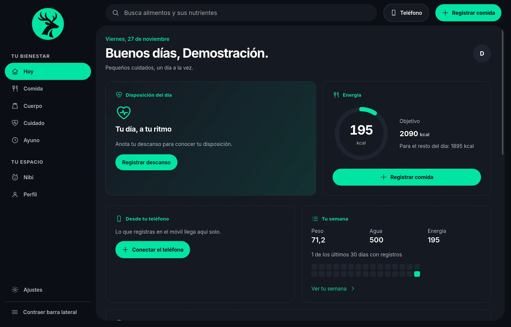
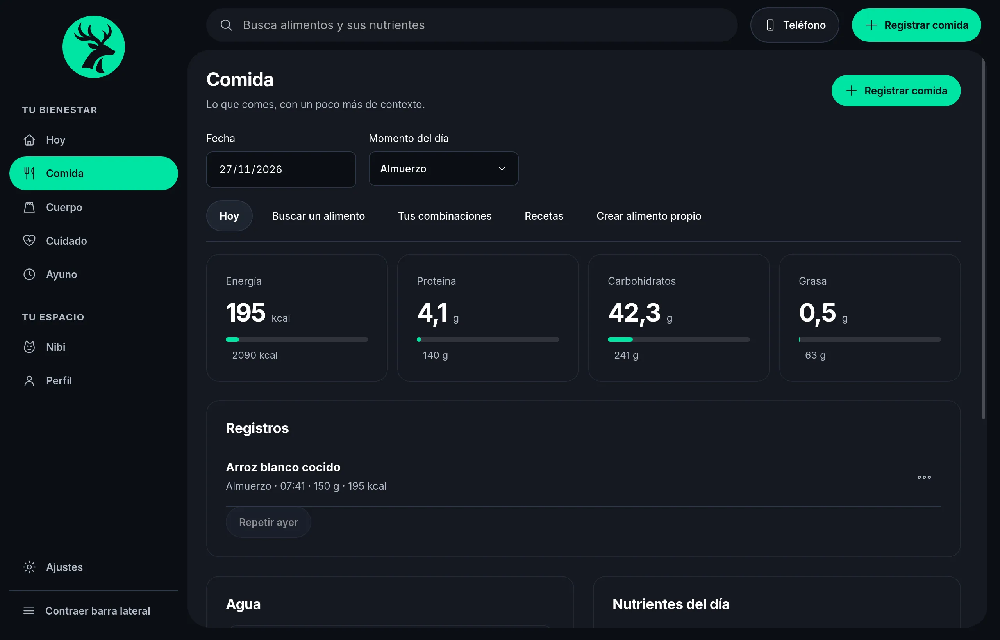
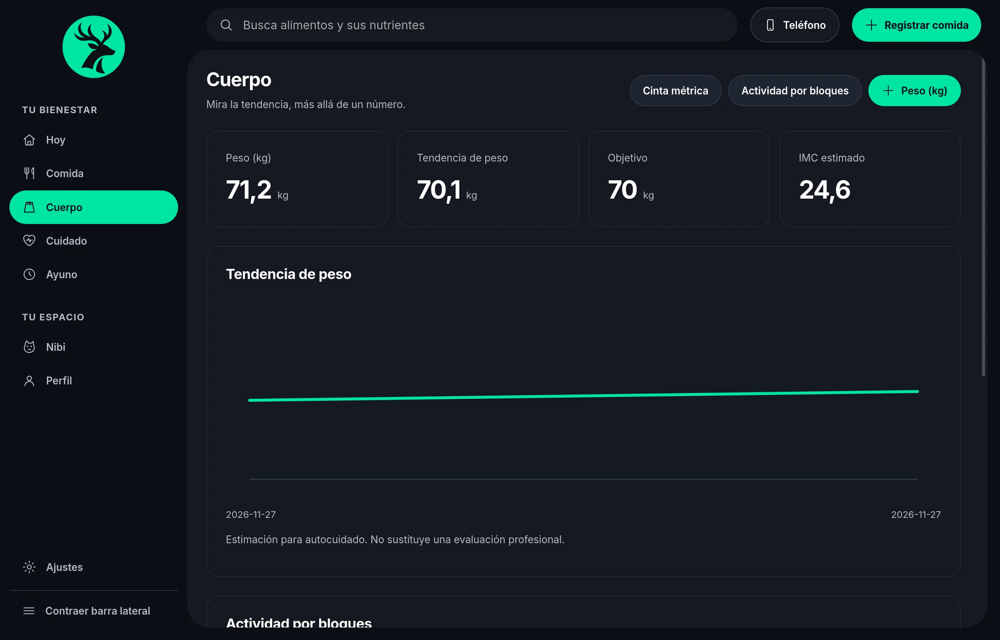
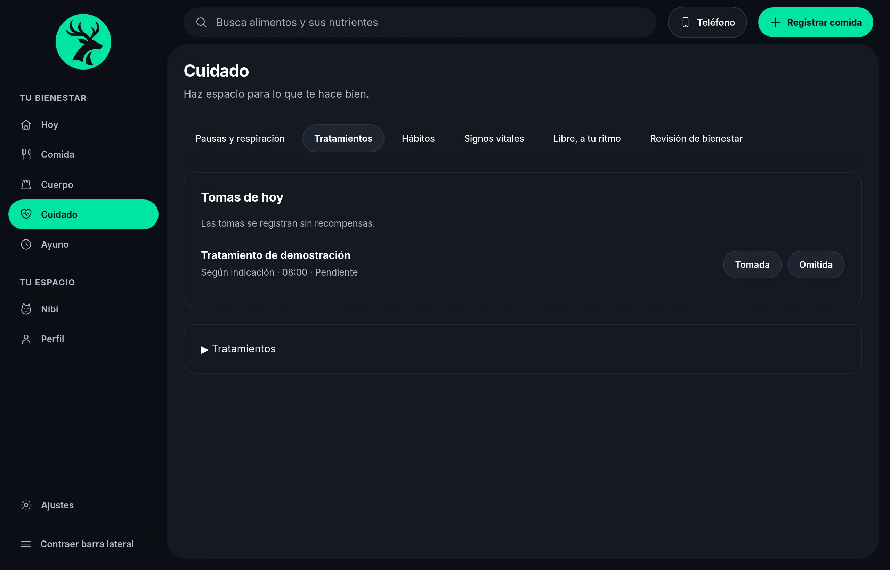
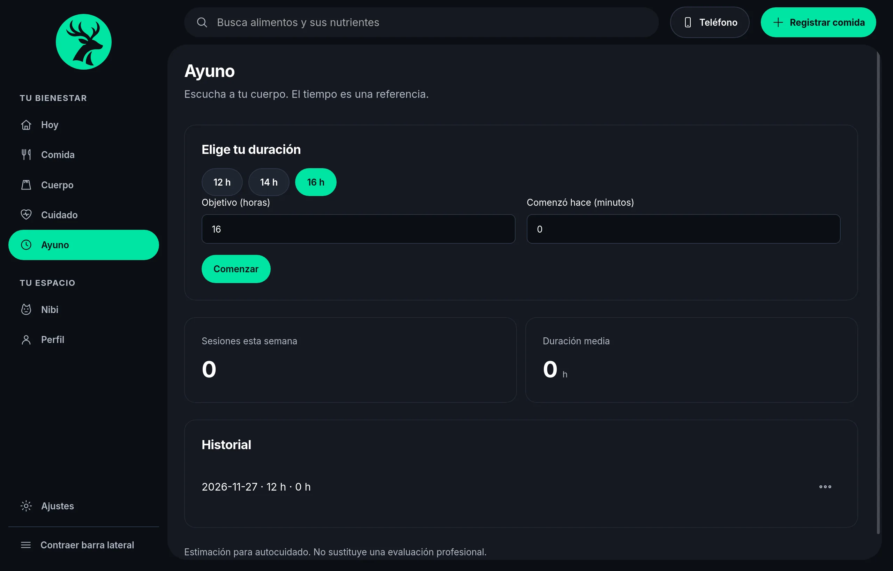
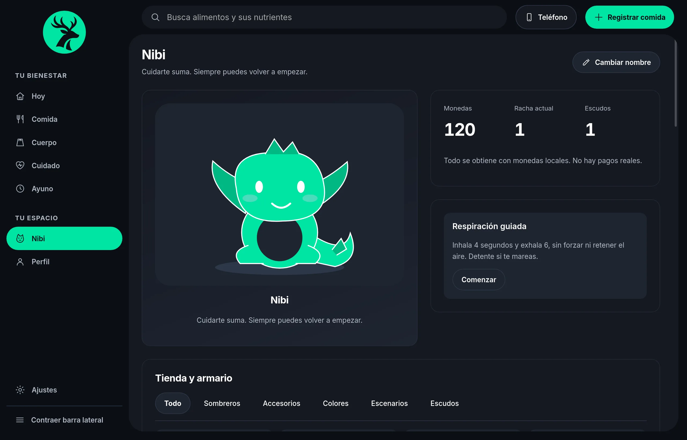
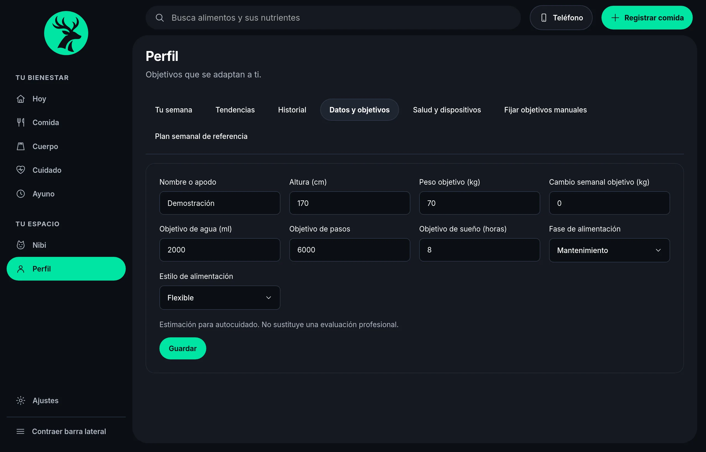
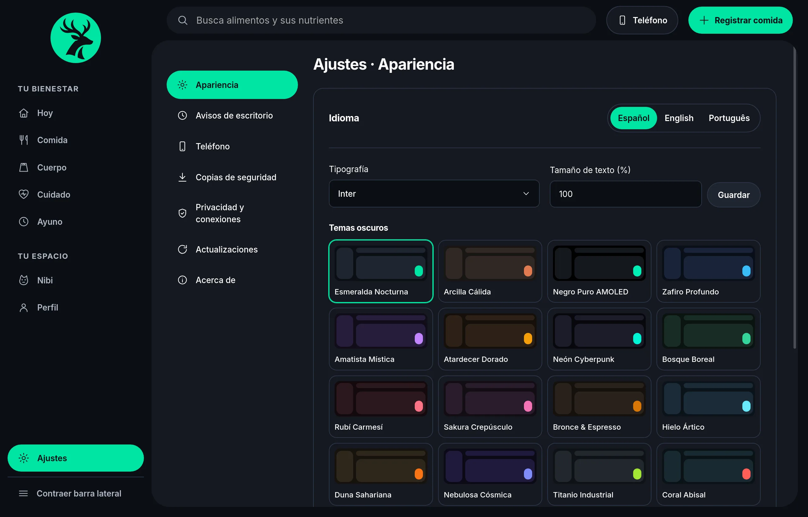

# NB SelfCare

  

  <strong>Tu salud, tu semana y tus hábitos en un solo lugar. En tus equipos, y en ningún otro sitio.</strong>

  <a href="README.md">English</a> · <strong>Español</strong>

---

## En pocas palabras

NB SelfCare es una aplicación de escritorio libre y de código abierto para el autocuidado diario: alimentación,
medidas del cuerpo, hábitos, tratamientos, ayuno y pausas guiadas. El teléfono registra el día con NB SelfCare Mobile;
el escritorio reúne los dos equipos por tu red local y te da espacio para mirar atrás: tu semana frente a la anterior,
tendencias de meses, patrones entre hábitos y un historial que puedes corregir. Funciona **sin conexión**, **sin
cuenta**, y **no envía nada** a ningún sitio salvo que enciendas un servicio concreto. Forma parte de la suite NB
Digital.

## Funciones

| Área | Qué tienes |
|---|---|
| **Hoy** | Disposición, energía y objetivos, lo registrado hoy en cualquiera de los dos equipos, la semana de un vistazo y registro rápido con Ctrl + K |
| **Comida** | Catálogo sin conexión, nutrientes, comidas escritas con tus palabras, combinaciones, recetas por raciones y código de barras con consentimiento |
| **Cuerpo** | Peso, tendencia, cinta métrica y bloques de actividad |
| **Cuidado** | Tratamientos y tomas (nunca premiadas), hábitos, pausas guiadas y descanso visual 20-20-20, signos vitales, síntomas, chequeos y contadores para dejar hábitos |
| **Ayuno** | Protocolos, comprobaciones de seguridad, cronómetro e historial |
| **Nibi** | Un compañero con monedas locales, escudos de racha y armario gratuito |
| **Perfil** | Tu semana frente a la anterior, tendencias de hasta 180 días, patrones descriptivos, historial corregible, objetivos, ciclo y resumen imprimible |
| **Teléfono** | Sincronización en vivo con NB SelfCare Mobile por la red local: vinculación con QR, certificado fijado y revisión de cambios simultáneos |
| **Interfaz** | Español, inglés y portugués, con cambio al momento; 24 temas con Modo Papel, cinco tipografías y escala de texto |

Las fórmulas y rangos de salud son estimaciones de autocuidado, no diagnósticos ni prescripciones.

## Garantías de privacidad

Las aplica el código y las comprueban pruebas automáticas, no las promesas. La declaración completa está en
[PRIVACY.md](PRIVACY.md).

* **Cero telemetría.** Sin analítica, sin informes de fallos y sin seguimiento de uso. Los registros se quedan en tu
  disco y nunca contienen nombres, rutas, textos del diario ni tratamientos.
* **Una sola puerta de red.** Toda conexión saliente pasa por un único módulo con interruptor general y
  consentimiento por servicio; cualquier cliente de red fuera de él hace fallar las comprobaciones.
* **Solo tus equipos.** El enlace con el teléfono no sale de tu red local y va cifrado con certificado fijado. Sin
  nube y sin cuenta.
* **Tus secretos en tu llavero.** La identidad del enlace y los teléfonos vinculados viven en el llavero del sistema.

## Capturas y video

*Un recorrido corto grabado de la aplicación real ([MP4](docs/assets/video/nb-selfcare-demo-es.mp4)).*

| Hoy | Comida | Cuerpo |
|---|---|---|
|  |  |  |

| Cuidado | Ayuno | Nibi |
|---|---|---|
|  |  |  |

| Perfil | Ajustes | |
|---|---|---|
|  |  | |

Los nombres y registros de estas imágenes se generaron para la demostración; no son de nadie.

## Instalación

Descarga el paquete de tu sistema desde la [página de publicaciones](https://github.com/nb-digital-hq/nb-selfcare/releases)
y verifícalo con `SHA256SUMS` y su firma Ed25519 `SHA256SUMS.sig` ([cómo](docs/developer/releases.md#verificar-una-descarga)).
Los detalles por sistema están en [instalación](docs/user/installation.md).

Linux es la plataforma verificada. Windows y macOS se publican **sin haberse probado en un equipo real**. No llevan
firma de Microsoft ni de Apple: Windows muestra el aviso de SmartScreen y macOS pide autorizar la aplicación la
primera vez. Los informes desde esas plataformas son bienvenidos.

Para compilarlo: [puesta en marcha](docs/developer/setup.md).

## Documentación

| Si quieres... | Lee |
|---|---|
| Usar la aplicación | [Guía de uso](docs/user/README.md) |
| Entender cómo está hecha | [Arquitectura](docs/architecture/README.md) |
| Saber por qué está hecha así | [ADR](docs/adr/README.md) |
| Evaluarla para una institución | [Instituciones](docs/institution/README.md) |
| Contribuir | [CONTRIBUTING.md](CONTRIBUTING.md) y la [guía de desarrollo](docs/developer/README.md) |
| Trabajar en ella con un agente de IA | [AGENTS.md](AGENTS.md) |

## Licencia

NB SelfCare se publica bajo la licencia Apache 2.0. Ver [LICENSE](LICENSE), [NOTICE](NOTICE) y
[THIRD-PARTY-NOTICES.md](THIRD-PARTY-NOTICES.md). "NB", "NB Digital" y "NB SelfCare" son marcas de NB Digital
([marcas](docs/legal/trademark.md)).
