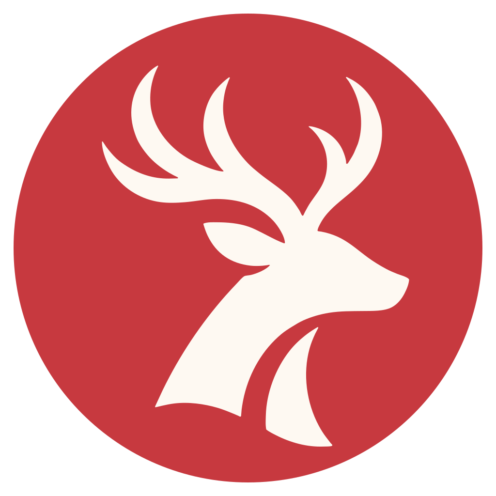
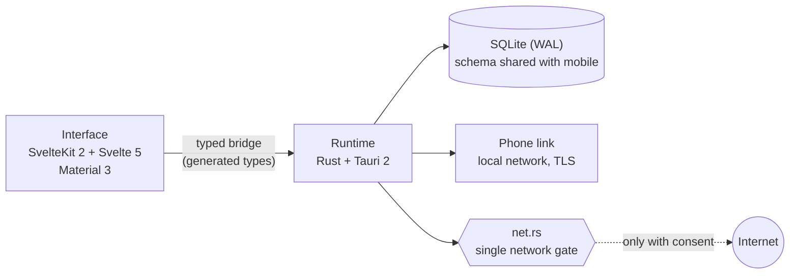
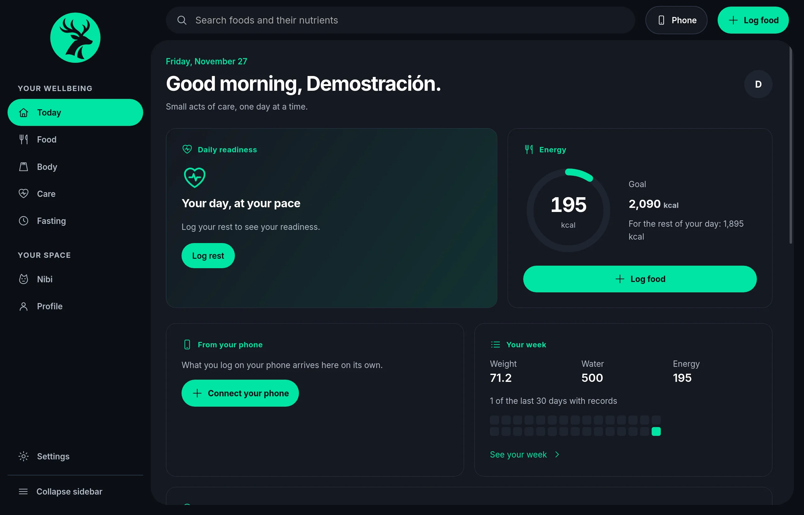
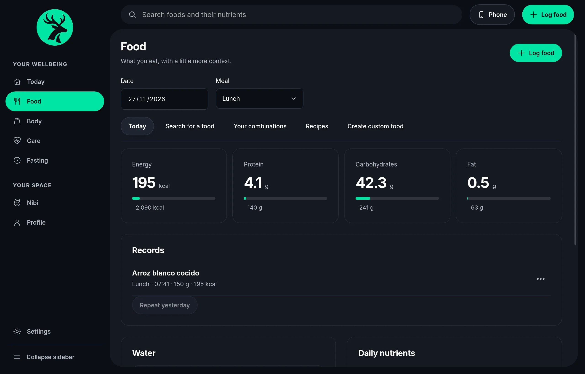
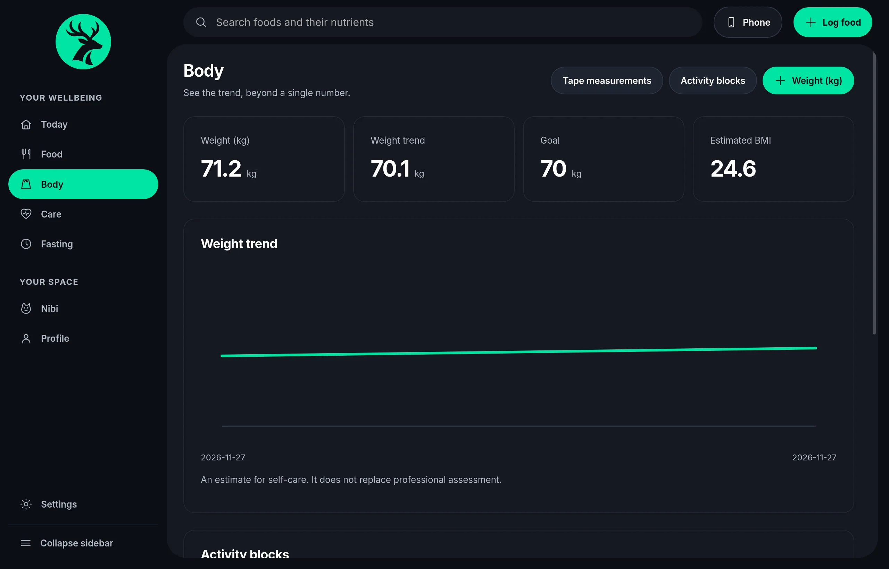
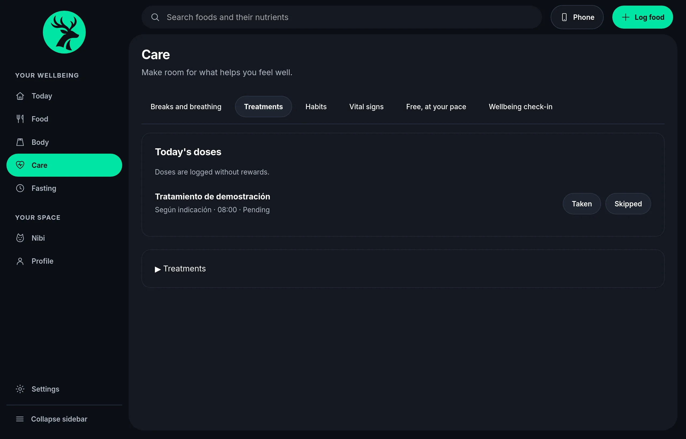
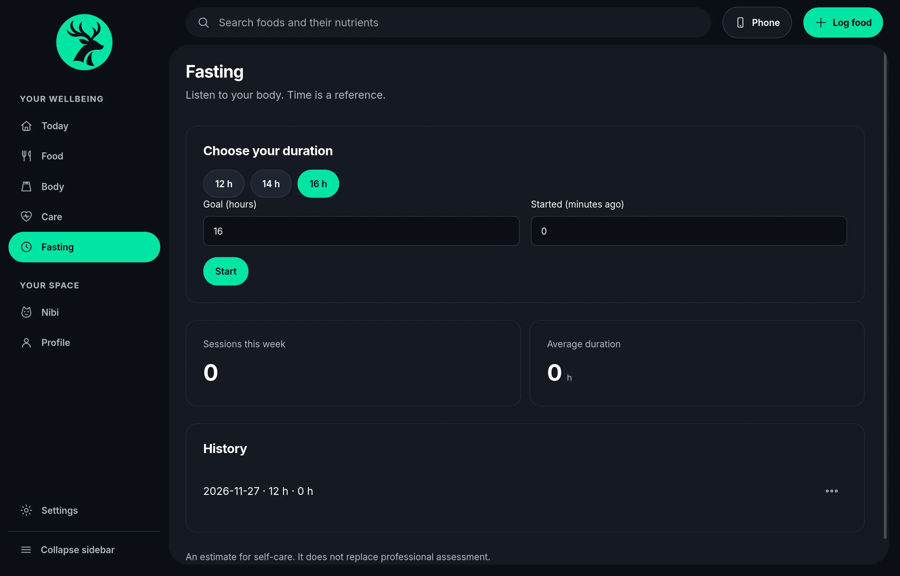
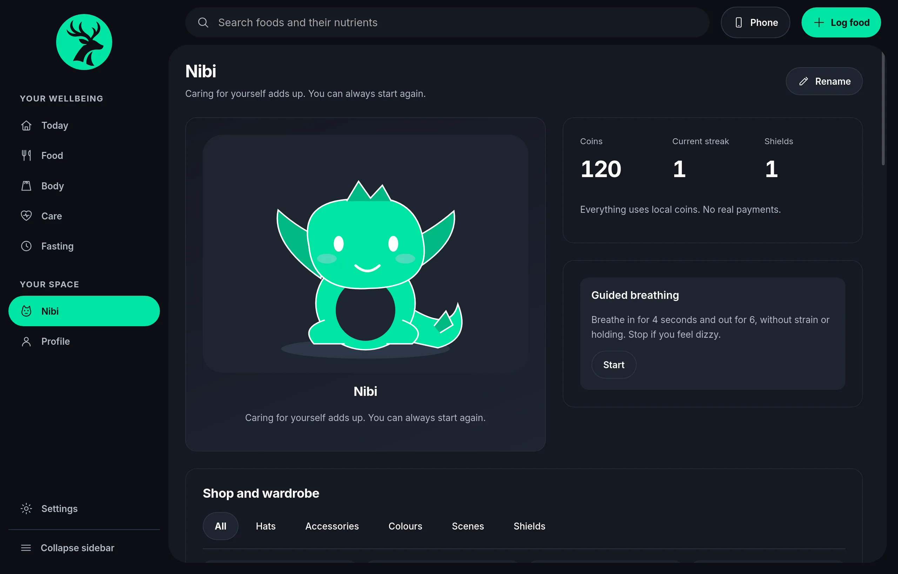
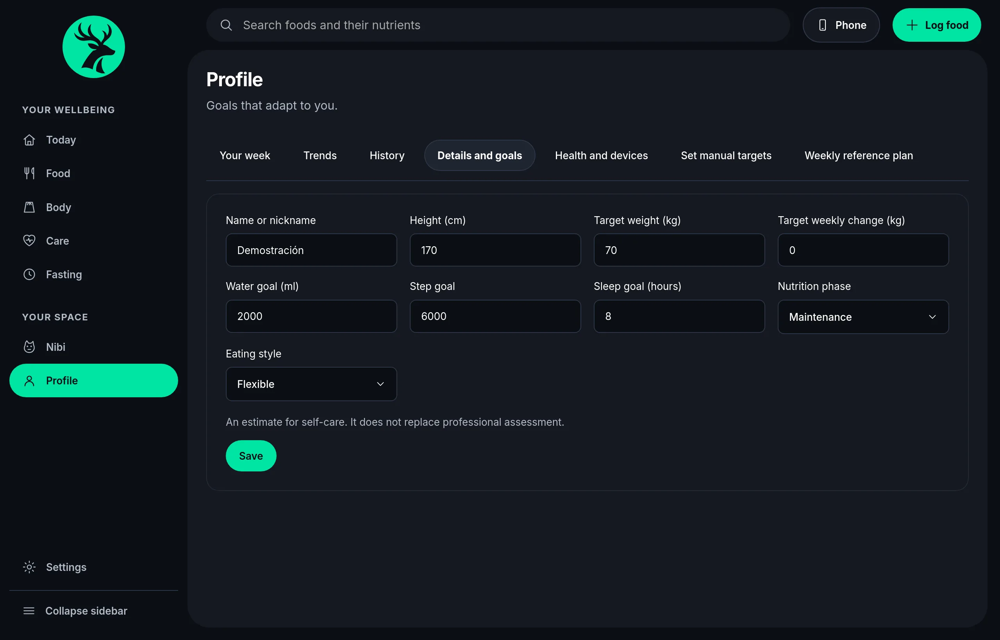
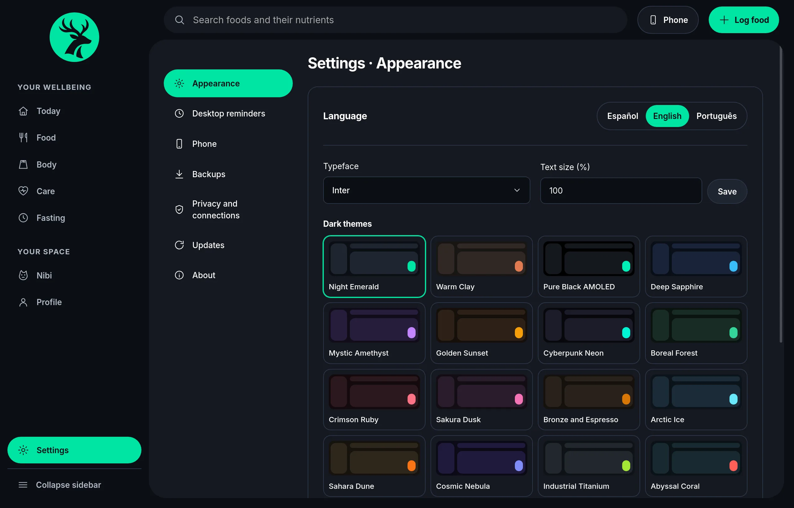

# NB SelfCare

<p align="center">
  
</p>

<p align="center">
  <strong>Your health, your week and your habits in one place. On your own devices, and nowhere else.</strong>
</p>

<p align="center">
  
  
  
  
  
  
</p>

<p align="center">
  <strong>English</strong> · <a href="README.es.md">Español</a>
</p>

---

## TL;DR

NB SelfCare is a free, open-source desktop app for everyday self-care: food, body measurements, habits, treatments,
fasting and guided breaks. Your phone captures the day with NB SelfCare Mobile; the desktop gathers both devices over
your local network and gives you room to look back: your week against the last, trends over months, patterns between
habits and a history you can correct. It works **fully offline**, needs **no account**, and sends **nothing**
anywhere unless you switch on a specific service. It is part of the NB Digital suite.

## Features

| Area | What you get |
|---|---|
| **Today** | Readiness, energy and goals, what was logged today on either device, the week at a glance and quick entry with Ctrl + K |
| **Food** | Offline catalogue, nutrients, meals typed in plain words, combinations, recipes by servings and barcode lookup with consent |
| **Body** | Weight, trend, tape measurements and activity blocks |
| **Care** | Treatments and doses (never rewarded), habits, guided breaks and 20-20-20 eye rest, vital signs, symptoms, check-ups and quit counters |
| **Fasting** | Protocols, safety checks, timer and history |
| **Nibi** | A companion with local coins, streak shields and a free wardrobe |
| **Profile** | Your week against the previous one, trends up to 180 days, descriptive patterns, a correctable history, goals, cycle tracking and a printable summary |
| **Phone** | Live sync with NB SelfCare Mobile over your local network: QR pairing, pinned certificate and review of simultaneous edits |
| **Interface** | Spanish, English and Portuguese, switched instantly; 24 themes including Paper Mode, five typefaces and text scaling |

Health formulas and ranges are estimates for self-care, not diagnoses or prescriptions.

## Privacy guarantees

Enforced by code and by automated checks, not by promises. The full statement is in [PRIVACY.md](PRIVACY.md).

* **Zero telemetry.** No analytics, no crash reporting, no usage tracking. Logs stay on your disk and never contain
  names, paths, journal text or treatments.
* **One network gate.** Every outgoing connection passes through a single module with a global switch and per-service
  consent; any network client outside it fails the build checks.
* **Your devices only.** The phone link stays on your local network, encrypted with a pinned certificate. There is no
  cloud and no account.
* **Your secrets in your keyring.** The link identity and paired phones live in the operating system's keyring.

## Architecture at a glance



More detail in [docs/architecture](docs/architecture/README.md) (Spanish).

## Screenshots and video

[](docs/assets/video/nb-selfcare-demo.mp4)

*A short tour recorded from the real application ([MP4](docs/assets/video/nb-selfcare-demo.mp4)).*

| Today | Food | Body |
|---|---|---|
|  |  |  |

| Care | Fasting | Nibi |
|---|---|---|
|  |  |  |

| Profile | Settings | |
|---|---|---|
|  |  | |

The names and records in these images were generated for the demonstration; they belong to no one.

## Quick install

Download the package for your system from the [release page](https://github.com/nb-digital-hq/nb-selfcare/releases)
and verify it against `SHA256SUMS` and its Ed25519 signature `SHA256SUMS.sig`
([how](docs/developer/releases.md#verificar-una-descarga)).

| System | Package |
|---|---|
| Debian, Ubuntu and derivatives | `.deb` |
| Fedora, openSUSE and derivatives | `.rpm` |
| Arch and any other distribution | `.tar.gz` (uses the system WebKitGTK) |
| Portable, no installation | AppImage |
| Windows 10 and 11 | `-setup.exe` or `.msi` |
| macOS on Apple Silicon | `.dmg` |

Linux is the verified platform. Windows and macOS are published **untested on real hardware**. They carry no
Microsoft or Apple signature, so Windows shows a SmartScreen warning and macOS asks you to allow the app the first
time. Reports from those platforms are welcome.

To build from source:

```bash
pnpm install && pnpm build
pnpm tauri dev
```

Requirements and details: [developer setup](docs/developer/setup.md) (Spanish).

## Documentation

| If you want to... | Read |
|---|---|
| Use the application | [User guide](docs/user/README.md) |
| Understand how it is built | [Architecture](docs/architecture/README.md) |
| Know why it is built this way | [ADR](docs/adr/README.md) |
| Evaluate it for an institution | [Institution](docs/institution/README.md) |
| Contribute | [CONTRIBUTING.md](CONTRIBUTING.md) and [developer guide](docs/developer/README.md) |
| Work on it with an AI agent | [AGENTS.md](AGENTS.md) |

## Licence

NB SelfCare is released under the Apache License 2.0. See [LICENSE](LICENSE), [NOTICE](NOTICE) and
[THIRD-PARTY-NOTICES.md](THIRD-PARTY-NOTICES.md). "NB", "NB Digital" and "NB SelfCare" are trademarks of NB Digital
([TRADEMARKS.md](TRADEMARKS.md)).
